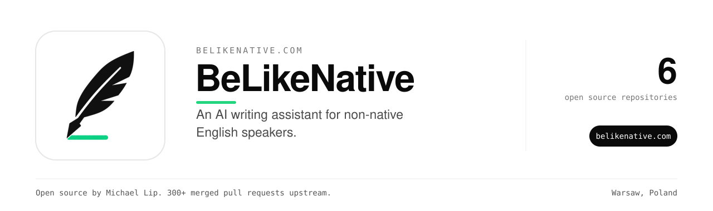

BeLikeNative helps people who write in English as a second language.
Select text and press one shortcut. It fixes grammar, rewrites for tone or translates, in the page you are on.

### Open source

| Repository | What it does |
| --- | --- |
| [belikenative-grammar-check](https://github.com/theluckystrike/belikenative-grammar-check) | A GitHub Action that checks grammar in pull requests and explains errors common to your first language. |

The extension and its backend are private.

### Links

Install the extension and read the guides at [belikenative.com](https://belikenative.com).
Follow updates on [X](https://x.com/BeLikeNative).

### Repositories

| Repository | What it does |
| --- | --- |
| [ReadabilityScoreKit](https://github.com/BeLikeNative/ReadabilityScoreKit) | Six classic English readability formulas in Swift: Flesch Reading Ease, Flesch-Kincaid, Gunning Fog, SMOG, Coleman-Liau and ARI. No dependencies. |
| [ReadabilityScores.jl](https://github.com/BeLikeNative/ReadabilityScores.jl) | Flesch reading ease, Flesch-Kincaid grade and Gunning fog for English text, from a single tokenisation pass. Zero dependencies. |
| [esltextstats](https://github.com/BeLikeNative/esltextstats) | Simple readability statistics for ESL writing (Flesch Reading Ease helper) |
| [ocaml-readability-metrics](https://github.com/BeLikeNative/ocaml-readability-metrics) | Classic English readability metrics for OCaml (Flesch, Flesch-Kincaid, Gunning fog, SMOG, Coleman-Liau, ARI, LIX, RIX) with no dependencies outside the standard library |
| [plainscore-d](https://github.com/BeLikeNative/plainscore-d) | Readability scoring and wordy-phrase detection for English prose, in D. Six formulae over one tokenisation pass, no dependencies beyond Phobos. |

### Maintainer

Built and maintained by [Michael Lip](https://github.com/theluckystrike) in Warsaw, Poland.
He also fixes bugs in projects he uses. He has 300+ merged pull requests in 200+ outside repositories, including [urllib3](https://github.com/urllib3/urllib3/pull/5330), [Appium](https://github.com/appium/appium/pull/22911), [Prefect](https://github.com/PrefectHQ/prefect/pull/21916) and [Google Chrome extension samples](https://github.com/GoogleChrome/chrome-extensions-samples/pull/1629).
Need an engineer for your own product or AI agent? Send a written brief at [axdale.com](https://www.axdale.com/?utm_source=github&utm_medium=org&utm_campaign=hire&utm_content=BeLikeNative).
